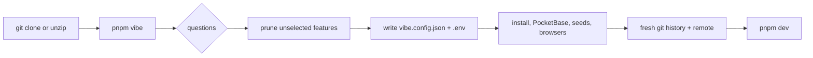
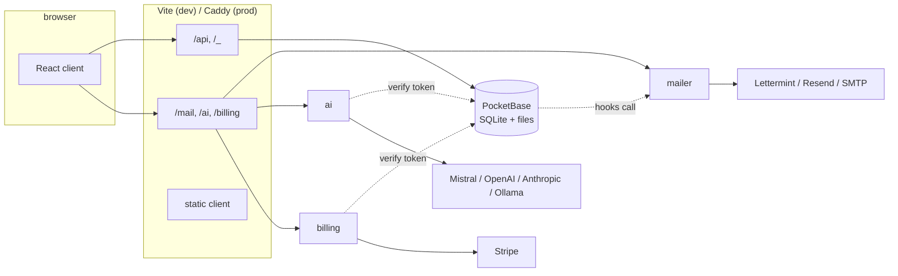
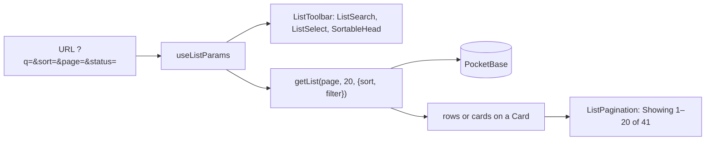
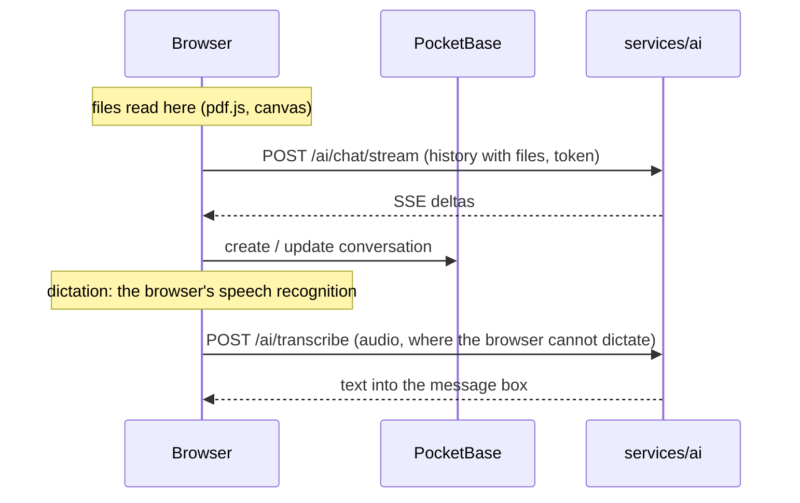
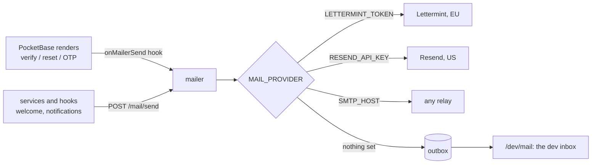
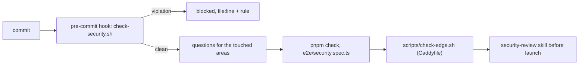
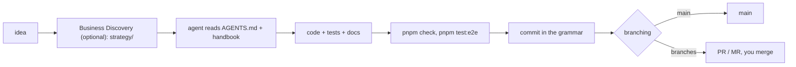

# Vibe Coding Standard: Handbook

The technical reference for projects built on this template. Short on purpose: tables, diagrams
and the one paragraph you need per topic. Rules agents must follow live in [AGENTS.md](../AGENTS.md);
this handbook explains how the pieces fit. The template version this describes is the
`templateVersion` in `vibe.config.json`.

**Contents**

1. [What you get](#1-what-you-get)
2. [Architecture](#2-architecture)
3. [Client](#3-client)
4. [Backend](#4-backend)
5. [Services](#5-services)
6. [Auth, accounts and email](#6-auth-accounts-and-email)
7. [Testing](#7-testing)
8. [Deployment](#8-deployment)
9. [Security](#9-security)
10. [Working with agents](#10-working-with-agents)

## 1. What you get

A pnpm monorepo for small-to-medium web apps where an AI coding agent does most of the typing.
`pnpm vibe` asks a few questions, removes what you did not pick, and bootstraps a running stack.

| Decision in the wizard | Options                                                 | What changes                                                  |
| ---------------------- | ------------------------------------------------------- | ------------------------------------------------------------- |
| Features               | AI (+ MCP server), Stripe, PDFs, social login, i18n     | whole folders, routes, migrations and dependencies are pruned |
| AI provider            | Mistral, OpenAI, Anthropic, Ollama                      | `AI_PROVIDER` and the key hint in `.env`                      |
| Analytics / errors     | none, Plausible, PostHog (+ its error tracking), Sentry | analytics module, consent banner, monitoring module           |
| Email provider         | Lettermint (EU), Resend (US), SMTP relay, later         | the key hint in `.env`; code is the same                      |
| Deploy target          | Fly.io, Hetzner (Docker Compose), both                  | `deploy/fly` and/or `deploy/hetzner`, CI deploy jobs          |
| Website                | none, on the app's server, Cloudflare Pages             | `web/` (Astro landing page) kept or removed, its deploy       |
| Git host and CLI       | GitHub, GitLab, other; CLI on or off                    | CI config, PR/MR template, how agents open PRs                |
| Branching              | commit to `main`, feature branches + PRs                | the agent's git behaviour                                     |

Always included: React client, PocketBase, the mailer, Jest and Playwright, four states per view,
settings, dev inbox, an installable app (PWA), a brand kit, Business Discovery (`strategy/`),
conventions and CI. No API key is needed: AI echoes, Stripe fakes checkout, mail stays local.

## 2. Architecture

| Workspace          | Role                                                                 | Port |
| ------------------ | -------------------------------------------------------------------- | ---- |
| `client/`          | React 19, Vite, Tailwind v4, shadcn/ui, React Query, react-router v7 | 5173 |
| `server/`          | PocketBase binary, JS migrations and hooks, TypeScript seeds         | 8090 |
| `services/mailer/` | every email in the stack: templates, provider switch, dev outbox     | 8788 |
| `services/ai/`     | chat and summarize behind PocketBase auth, four providers            | 8787 |
| `services/mcp/`    | MCP server: AI agents act for a user after OAuth consent             | 8791 |
| `web/`             | the website: landing page, imprint, privacy (Astro, static)          | 4321 |
| `e2e/`             | Playwright against the seeded local stack                            |      |
| `deploy/`          | Caddy, Dockerfiles, Fly.io apps, Docker Compose for a VPS            |      |

Principles that explain most of the code:

- **PocketBase is the source of truth.** The browser talks to it directly through the JS SDK;
  API rules enforce access. No Node API sits in front of plain CRUD.
- **Secrets never reach the browser.** Anything with an API key is a service under `services/`,
  reached through a same-origin prefix and authenticated by verifying the PocketBase token.
- **One `.env` at the root** feeds every workspace; `.env.example` documents each variable.
- **Relative URLs everywhere**; the proxy (Vite in dev, Caddy in prod) does the routing.

## 3. Client

| Where                     | What                                                           |
| ------------------------- | -------------------------------------------------------------- |
| `src/App.tsx`             | routes; protected ones sit under `ProtectedRoute`              |
| `src/routes/*.tsx`        | one file per page                                              |
| `src/lib/api/*.ts`        | pure data access (unit tested); `src/hooks/use-*.ts` wrap them |
| `src/components/`         | header, layout, widgets; `ui/` is shadcn and may be edited     |
| `src/lib/env.ts`          | the only reader of `import.meta.env`                           |
| `src/i18n/locales/*.json` | every visible string (English + German)                        |

Three patterns carry most pages:

**Four states.** Every data view renders loading, error, empty or content: a skeleton shaped like
the content (`LoadingRegion`, `TableSkeleton`, `PostCardSkeleton`), `EmptyState`, `ErrorState`.

**Lists.** A list sits on a card surface, sorts server-side, searches and filters through a
toolbar, and pages 20 at a time, with the state in the URL:

**Forms.** `react-hook-form` + `zod` + shadcn `Form`; the schema is built inside the component
so messages are translated; `applyServerErrors()` maps PocketBase field errors onto inputs.

Design: colours only through tokens in `styles.css` (`bg-primary`, ...). Form controls carry
`bg-field` (white in light mode) so they read as controls on the off-white page.

**Brand.** `corporate-identity/logo/mark.svg` and `brand.json` are the source; `pnpm brand` draws
every logo (SVG, PNG in four sizes), the app icons, avatars, banners and the link preview, listed in
`corporate-identity/README.md`. To change the logo, tell your agent "create a logo that ...".

**Installable app.** A manifest and a service worker (production builds; app shell only, never
data). On iOS the page draws edge to edge; edges pad by the safe-area insets (`pt-safe`, `pb-safe`).

## 4. Backend

PocketBase is one binary (version pinned in `server/.pocketbase-version`) plus three folders
that live in git:

| Folder           | Contents                                                  | Shipped                                                                                    |
| ---------------- | --------------------------------------------------------- | ------------------------------------------------------------------------------------------ |
| `pb_migrations/` | schema and API rules, one JS file per change, up and down | posts, public user profiles, first/last name, plus one per feature (subscriptions, locale) |

Hooks run in isolated VMs (no top-level state, `require()` inside the handler, `e.next()`); a
syntax error silently disables a whole hook file. `pnpm typegen` regenerates `pb-types.ts`.

## 5. Services

Each service is a Hono app on Node 24 of the same shape: routes in `src/app.ts` (unit tested with
fakes), wiring in `src/index.ts`, vendor code in `src/lib/` (untested on purpose), and
`src/lib/auth.ts` verifying the caller's PocketBase token.

| Service | Routes                                                             | Offline behaviour                   |
| ------- | ------------------------------------------------------------------ | ----------------------------------- |
| mailer  | `POST /mail/send` (template or raw), `GET /mail/outbox` (dev)      | outbox provider, nothing delivered  |
| ai      | `POST /ai/chat/stream` (SSE), `/ai/transcribe`                     | echo provider, fixed transcript     |
| mcp     | `/mcp` (tools), `/mcp/oauth/*`, `/.well-known/oauth-*` (discovery) | the same; agents need the app's URL |

The AI provider is `AI_PROVIDER` in `.env`: `auto` takes the first configured key (Mistral,
OpenAI, Anthropic), `ollama` talks to a local or self-hosted Ollama with no key. Models are
env variables too (`MISTRAL_MODEL`, `OPENAI_MODEL`, `ANTHROPIC_MODEL`, `OLLAMA_MODEL`).

The assistant page (`/assistant`) is a full chat: streamed Markdown replies (tables, task lists,
formulas; images show their alt text only), a history of conversations (new, rename, delete; saved
in the `conversations` collection, private to the user) and voice input. Where the browser
recognises speech (Chrome, Edge, Safari) the words appear while you speak, also while a reply is
being written: on the device when it has the language pack, otherwise through the browser
vendor's service (Google, Microsoft, Apple), which the privacy policy has to name
(`CLOUD_DICTATION = false` in `use-dictation.ts` keeps audio on the device). Elsewhere (Firefox)
a recording goes to `/ai/transcribe`; Mistral (Voxtral) and OpenAI have speech to text,
Anthropic and Ollama borrow whichever of those two has a key, and without any those browsers get
no microphone (`GET /ai/health` says `transcription`). Per-user rate limits (30 chat, 10 voice
requests a minute) are on in production, `RATE_LIMITS=on|off` overrides.

Files (images, PDFs, text, code) are read in the browser (pdf.js, scaled images) and never stored:
the open chat sends them with every turn (up to 5), the saved conversation keeps their names only.

**MCP server**: agents such as Claude, ChatGPT and Cursor connect to `<app>/mcp`; the user approves
each on `/connect` (deleting starts unticked) and the agent acts as that user, so API rules apply as
in the browser. Settings lists connections and access tokens with Disconnect and the last tool
calls. A tool is one file in `services/mcp/src/tools/`; AGENTS.md has the recipe.

To add a service: copy `services/mailer/`, pick a unique prefix, add the proxy entry in
`client/vite.config.ts` and `deploy/Caddyfile`, and a block in `docker-compose.yml`.

## 6. Auth, accounts and email

PocketBase owns sessions. The client's `auth-context.tsx` wraps login, registration, logout,

and per-user side effects. Settings edits the name, changes the password (PocketBase then ends
every session and signs you in again) and turns on two-factor sign-in per user: an authenticator
app (QR code, ten recovery codes) or email codes, asked for after the password (`two-factor.pb.js`).

Email has one path:

PocketBase never speaks SMTP itself, so the mailer's variables are the only email configuration.
Before going live: add the sending domain's DKIM, SPF (or return-path) and DMARC records at the
provider and set a real `MAIL_INTERNAL_TOKEN`. In development every mail is at `/dev/mail`. Mail to
reserved domains (`example.com`, `.test`, the seed users) never reaches a real provider.

## 7. Testing

| Layer       | Tool                           | Where                           | Proves                                           |
| ----------- | ------------------------------ | ------------------------------- | ------------------------------------------------ |
| Unit        | Jest                           | `*.test.ts[x]` next to the code | pure functions, hooks, pages per state, handlers |
| End to end  | Playwright                     | `e2e/<feature>.spec.ts`         | every user-facing flow against the seeded stack  |
| Conventions | `scripts/check-conventions.sh` | CI on pull requests             | commit subjects, branch names, PR titles         |

`pnpm check` runs Prettier, ESLint, `tsc` and Jest; `pnpm test:e2e` boots the stack if needed.
Specs create unique records and run in parallel, without network (AI, Stripe and email have
offline doubles). Data views get a row in `e2e/loading.spec.ts`, lists one in `e2e/lists.spec.ts`.

## 8. Deployment

Every target runs the same images: Caddy terminates TLS, routes `/api` to PocketBase, each service
prefix to its container and the rest to the static client; the admin UI only through a tunnel.
Tiers `dev`, `stage` and `prod` each have an env file (`deploy/.env.<tier>`) and servers or apps.
The website (`web/`, its own domain) has the same tiers; `deploy/README.md` says where it runs.

| Target | Setup                                                  | Every release      |
| ------ | ------------------------------------------------------ | ------------------ |
| Fly.io | `pnpm deploy:prod --init` once (apps, volume, secrets) | `pnpm deploy:prod` |

GitHub Actions (`.github/workflows/`) run the naming check on pull requests, then check, build
and Playwright. The deploy workflows deploy dev after every green CI run on `main` (once
`AUTO_DEPLOY_DEV` is `true`) and stage or prod by hand, with secrets per GitHub Environment.

`pnpm deploy:dev` deploys dev, `DEPLOY_ENV=stage pnpm deploy:prod` stage, no code changes for
either. Data lives in the `pb_data` volume; back it up from the PocketBase admin.

## 9. Security

The template ships the fixes from three security reviews of apps built on it, and rules that keep
new code from repeating them; `docs/security-checklist.md` lists each with its incident.

| Layer    | What protects it                                                                          |
| -------- | ----------------------------------------------------------------------------------------- |
| Data     | API rules per owner, ownership fields fixed on update, `users.deleteRule` closed          |
| Abuse    | PocketBase rate limits per IP in production, per-user limits and body limits in services  |
| Services | token check, no client-supplied prompts or ids, fixed error texts, no placeholder secrets |
| Browser  | CSP (this origin only), HSTS, auth links to the app's own pages, Markdown without images  |
| Privacy  | users identified by id, URLs redacted before analytics and error reports                  |
| Edge     | admin UI, superuser API and mailer answer 404; images as non-root; pinned checksums       |
| CI       | actions pinned to SHAs, read-only tokens, untrusted text through `env:`                   |

Machines check what they can on every commit; the questions cover the rest. Before a launch, say
"review security": the skill probes the app with throwaway users (`docs/security-review-<date>.md`).

## 10. Working with agents

AGENTS.md is the contract: the stack, where things are, how a feature is added, what "done" means.
Agents commit in the commit grammar, follow `vibe.config.json` (branching, git host) and open PRs.

Say "Business Discovery" first for the plan (`strategy/`); drop screenshots, designs and documents
into `references/` (git-ignored): agents read it, `status` suggests an action per file. Shortcuts:
`issues 20`, `bugs`, `features`, `status` (AGENTS.md section 13); UI work: the skills of section 12.
"Write the landing page" runs the website skill, starting from your product definition.
